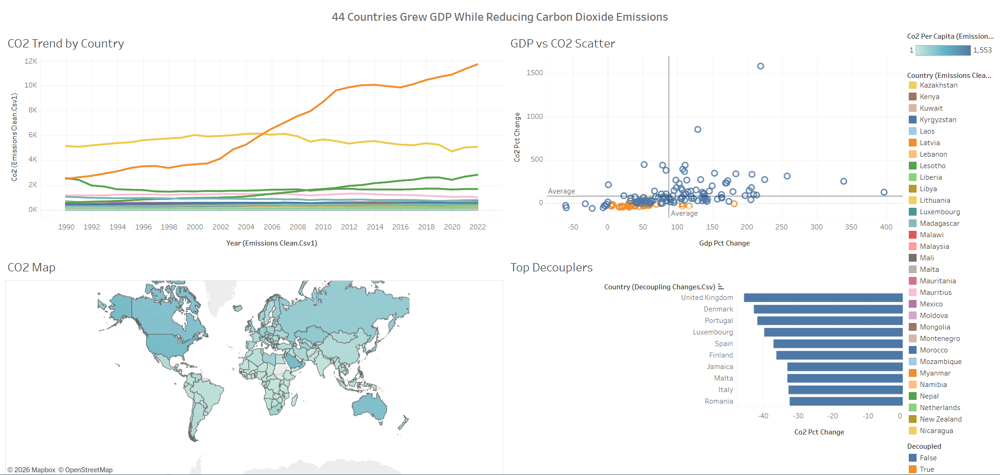
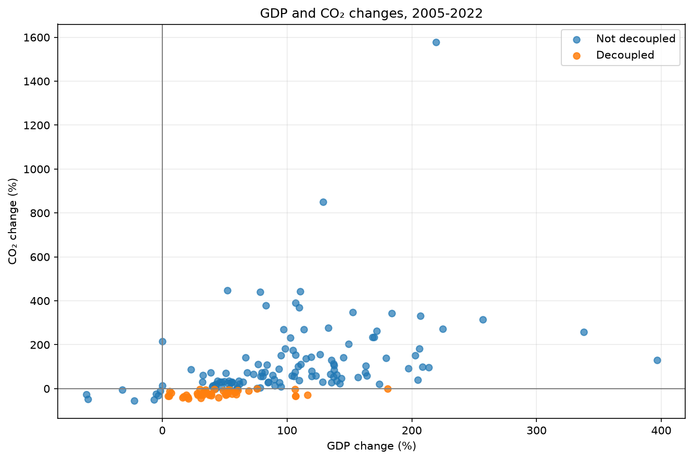
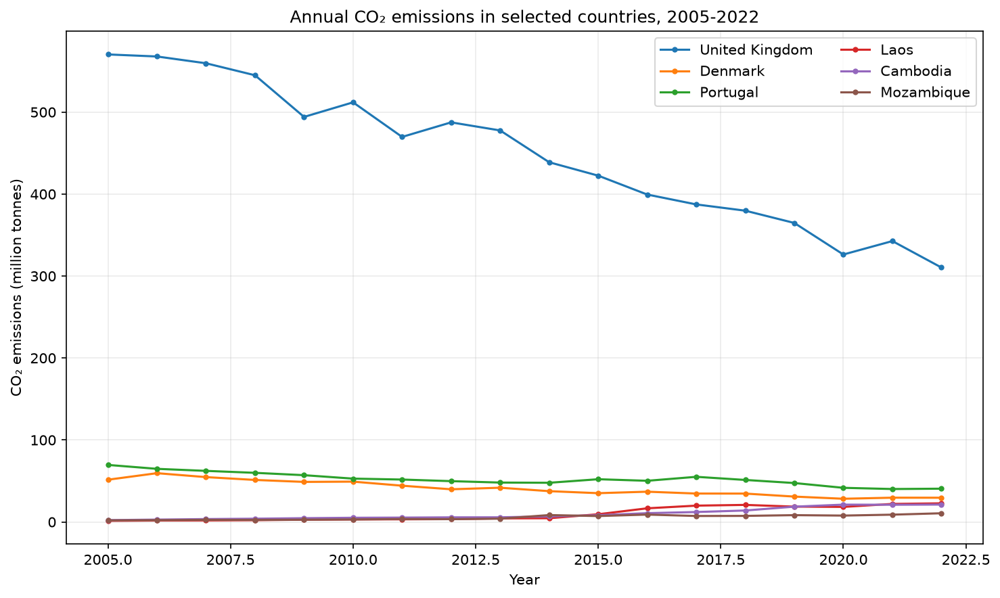
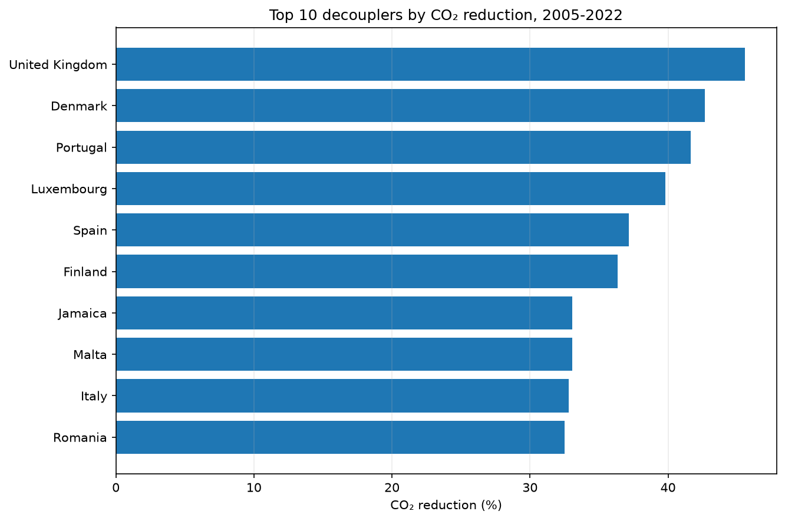

# CO₂ Decoupling Analysis

This project explores whether countries experienced economic growth while reducing their annual CO₂ emissions. It uses country-level data from Our World in Data (OWID).

   ## Interactive Dashboard
   [View the live dashboard on Tableau Public](https://public.tableau.com/app/profile/advait.risbud/viz/CO2EmissionvsEconomicGrowth/CountriesDashboard?publish=yes)

   

## Research question

Between 2005 and 2022, which countries had rising GDP and falling total CO₂ emissions? How did CO₂ emissions per unit of GDP change in those countries?

## Data

- **Source:** [Our World in Data CO₂ dataset](https://github.com/owid/co2-data)
- **Local input:** `data/raw/owid_co2.csv`
- **Download date:** November 12, 2026
- The cleaning process keeps country-level rows from 1990 onward, selects the variables needed for the analysis, and removes rows missing population, GDP, or CO₂ data.

## Run the analysis

Install the project dependencies:

```bash
python -m pip install -r requirements.txt
```

From the project root, clean the data:

```bash
python -m src.clean
```

Then open notebooks/analysis.ipynb and run the cells from top to bottom. The notebook previews the data, shows top emitters and the global emissions trend, compares the country-level changes, and creates charts in outputs/figures/.

## Method
- The comparison uses each country's values in 2005 and 2022
- Countries without data for both comparison years are excluded
- A country is labeled absolutely decoupled if GDP increased and its total CO₂ emissions decreased over the period
- The analysis also compares percentage changes in CO₂ per unit of GDP between countries labeled decoupled, and the rest

## Findings
- 44 of 164 countries with data at both endpoints meet the requirement of absolute-decoupling
- NOTE: if input data is updated in the future, another analysis will be necessary

## Charts

### GDP change vs. CO₂ change


### Country case studies


### Largest CO₂ reductions among decouplers


## Limitations
- Requiring complete data for both endpoints means there is bias towards wealthier and better documented countries
- The decoupling definition uses GDP and total CO₂ changes while the t-test compares CO₂-per-GDP changes across groups defined using those same quantities
    - The t-test is circular and should be treated as exploratory—not independent confirmation or evidence of causation
- The analysis is focusing on CO₂ and not other greenhouse gases
- The analysis does not focus on why a country's emissions changed